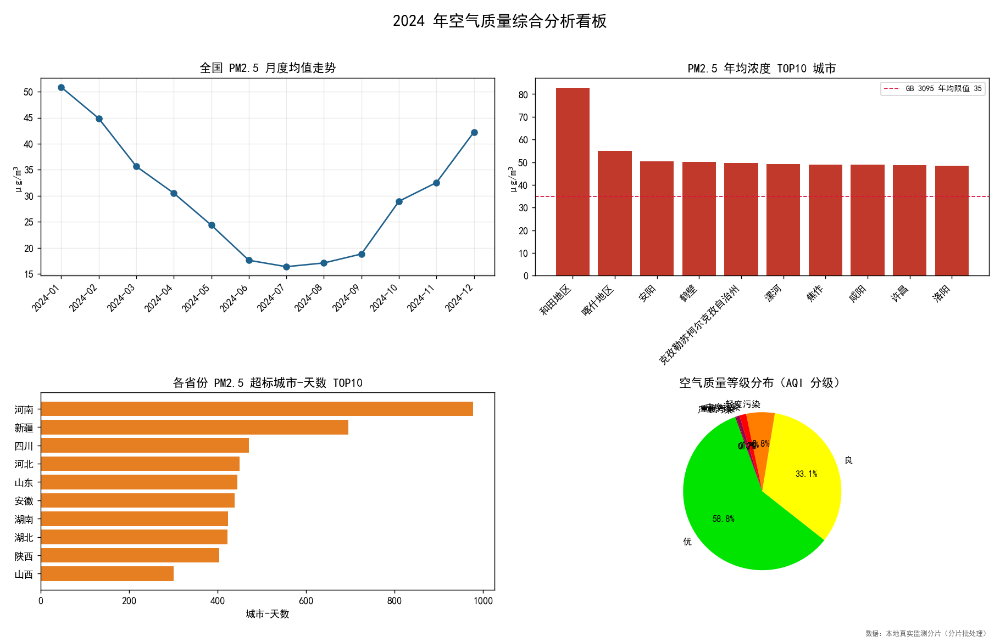

# 空气质量时序分析 Agent（Hadoop + MySQL + Python）

> OHCP 一小时智能编程大赛参赛作品：自然语言驱动的空气质量大数据分析 Agent。
> 全链路：**真实数据 → 分片清洗 → HDFS → Hive 数仓 → MapReduce 对账 → MySQL → ReAct Agent → 图表 + 结论**。
> 全程本地数据、可复现、可测试，现场不联网下载数据。
>
> **License：MIT**（见 [LICENSE](LICENSE)）。仓库包含 2024 年全量真实数据与清洗分片
> （约 560MB，克隆会稍慢），克隆后可直接一键运行；数据版权归原始发布机构，
> 不适用 MIT，详见 [`data/README.md`](data/README.md)。

---

## 一、这个项目解决了什么？

环境监测平台每天产生海量城市空气质量时序记录，普通用户不会写 SQL、不会清洗数据。
本项目让用户**用一句中文提问**，Agent 自动规划并调用工具完成：

```
读取本地分片数据 → 缺失/异常清洗 → 按月/城市/省份聚合 → 按 GB 3095-2012 判定超标
→ 生成图表 → 输出结构化结论（含国标科普与 1~2 行生态感悟）→ 结果自校验
```

题面 3 个示例提问均可直接运行：

| 示例提问 | Agent 输出 |
| --- | --- |
| 找出 2024 年 PM2.5 年均浓度最高的 5 个城市，画出月度变化曲线 | TOP5 排名 + 超标研判 + 折线图 |
| 筛选 PM2.5 超标记录，统计各省份超标天数占比 | 各省超标城市-天数、占比、超标率 + 饼图 |
| 统计北京市夏季臭氧 O₃ 超标总天数 | 超标天数、超标率、逐月分布柱状图 |

额外支持多轮追问（"再看这几个城市的 PM10 超标情况"）与突变告警
（"检测北京市 PM2.5 异常突变"）。

### 效果预览



- 答辩 HTML 幻灯片：[`docs/答辩演示.html`](docs/答辩演示.html)（独立文件，不是产品前端）
- Agent 演示记录（5 个问题 + 工具轨迹）：[`output/04_Agent演示记录.md`](output/04_Agent演示记录.md)
- 测试报告（37 项）：[`output/test_report.txt`](output/test_report.txt)
- 三方对账：[`output/hive_vs_pandas.json`](output/hive_vs_pandas.json)、
  [`output/mapreduce_vs_hive.json`](output/mapreduce_vs_hive.json)、
  [`output/mysql_vs_local.json`](output/mysql_vs_local.json)

---

## 二、快速开始

### 0. 获取代码

```bash
git clone git@github.com:arrebolbay/HADOOP-OHCP.git
cd HADOOP-OHCP
# 仓库约 600MB（含全量数据），克隆需要一点时间
```

### 1. 环境

| 组件 | 版本 | 用途 |
| --- | --- | --- |
| Hadoop（HDFS + YARN + Streaming） | 3.3.6 | 分布式存储 + MapReduce 计算 |
| Hive | 3.1.3 | ODS/DWD/DWS/ADS 数仓建模 |
| MySQL | 8.0 | 结果库（Agent/前端快速查询） |
| Python | 3.10 | Agent、清洗、聚合、绘图、测试 |
| pandas / matplotlib / pymysql / requests | 见 requirements.txt | 计算与可视化 |

```bash
# 启动大数据环境（本项目已适配 /opt 下的安装路径）
/opt/hadoop/sbin/start-dfs.sh && /opt/hadoop/sbin/start-yarn.sh
jps          # 应看到 NameNode / DataNode / ResourceManager / NodeManager

# 安装 Python 依赖（环境已自带可跳过）
pip install -r requirements.txt
```

### 2. 数据（已随仓库提供，可直接运行）

仓库已包含 2024 年真实数据、按月分片与清洗分片，**克隆后无需下载即可启动**。
数据说明与版权声明见 [`data/README.md`](data/README.md)。

如需重新下载 / 重建（可选）：

```bash
python3 scripts/download_real_data.py --start 2024-01-01 --end 2024-12-31 --workers 6
# 城市→省份参考表已随仓库提供；如需重新生成（联网）：
# python3 scripts/build_province_map.py
```

> 也可以把天池数据集（dataId=14038）导出为长表 CSV 放到 `data/raw/tianchi/`，
> `step02` 会自动识别（见《数据集说明.md》）。

### 3. 一键启动（推荐）

```bash
# 可选：新克隆自检（依赖、数据、37 项测试）
python3 scripts/check_fresh_clone.sh

chmod +x start.sh
./start.sh                 # 后端 API + 前端页面一起启动，自动打开浏览器
./start.sh --planner=rule  # 无网络 / 无大模型 Key 时的演示模式
./start.sh --port=8080 --prepare   # 指定端口并重建分片/清洗
```

| 参数 | 作用 |
| --- | --- |
| `--port=8080` | 指定端口（默认 8000） |
| `--planner=auto\|rule\|llm` | 规划器模式；现场演示建议 `rule` 保底 |
| `--prepare` | 强制重跑 step02 + step03（数据有更新时） |
| `--no-browser` | 不自动打开浏览器（录屏时手动控制更稳） |

> Windows 下可双击 `start.bat`（通过 WSL 调用 `start.sh`）。
> 启动脚本会先检查依赖、数据，再拉起 Web 服务（前端与 API 同进程），
> 最后自动打开 `http://127.0.0.1:8000`。

### 4. 一键跑通全链路（离线批处理）

```bash
python3 run_all.py            # 第 1~12 步
python3 run_all.py --list     # 只看步骤
python3 run_all.py 10 12      # 大数据链路已就绪时，只跑 Agent 演示/看板/测试
```

### 5. 只跑 Agent（命令行演示）

```bash
AQ_PLANNER=rule python3 steps/step10_agent_demo.py
```

### 6. 网页前端

```bash
python3 web/server.py                 # http://127.0.0.1:8000
python3 web/server.py --port 8080 --planner rule
```

- 零额外依赖（Python 标准库 `http.server`），不装 Flask；
- 页面包含：数据概览、快捷提问、ReAct 轨迹、四段式结论、图表画廊、校验徽章、多轮记忆；
- 服务端常驻同一个 Agent 实例，网页上可直接追问（"再看这几个城市的 PM10"）；
- 接口：`/api/health`、`/api/overview`、`/api/ask`、`/api/reset`、`/charts/<png>`。

### 7. 答辩材料（HTML，不是 PPT）

| 文件 | 用途 |
| --- | --- |
| `docs/答辩演示.html` | 7 页 HTML 幻灯片：技术栈 / 架构 / 优缺点 / 证据 / 录屏路线；`←/→` 翻页、`N` 看讲稿、`F` 全屏 |
| `docs/答辩讲稿与录屏脚本.md` | 1.5 分钟逐字稿 + 3.5 分钟录屏操作脚本 + 常见提问速答 |

> 注意：`docs/答辩演示.html` 是**答辩用 HTML 幻灯片**（独立文件，直接双击打开），
> 不是 `web/` 里的产品前端；两者互不依赖，现场可以先放幻灯片再切到产品录屏。

---

## 三、目录结构

```
OHCP/
├── run_all.py                  ★ 一键入口（12 步）
├── config.py                   配置中心：路径 / Hadoop / MySQL / LLM / 阈值
├── common.py                   公共工具箱：命令、HDFS、Hive、MySQL、表格打印
├── requirements.txt
├── agent/                      ★ Agent 层
│   ├── react_agent.py          ReAct 主循环（Thought→Action→Observation→结论）
│   ├── planner.py              双模规划器：LLMPlanner + RulePlanner + DualPlanner
│   ├── memory.py               多轮对话记忆（"这几个城市"指代解析）
│   ├── prompts.py              LLM 规划提示词与工具描述
│   └── tools/                  8 个独立工具（每个文件可单测）
│       ├── dataset_read_tool.py    分片读取与数据概况
│       ├── clean_tool.py           缺失值/异常值清洗
│       ├── aggregate_tool.py       时序/地域维度聚合
│       ├── gb3095_tool.py          国标超标判定 + 科普
│       ├── chart_tool.py           折线/柱状/饼图
│       ├── alert_tool.py           月度突变告警（创新）
│       ├── validate_tool.py        结果自校验 + 跨引擎对账（创新）
│       └── report_tool.py          简易版/专业版双模板输出
├── core/                       纯计算层（无 UI、可单测）
│   ├── data_store.py           分片引擎：日均/日最大8h/聚合/突变检测
│   ├── cleaning.py             清洗五步 + 清洗报告
│   └── gb3095.py               GB 3095-2012 限值判定唯一来源
├── steps/                      12 个可单独运行的步骤脚本
├── sql/hive/                   ODS 外部表、DWD/DWS/ADS 建模
├── sql/mysql/                  事实表/维表/视图/存储过程/事件
├── mapreduce/                  Python 写的 Streaming mapper/reducer
├── web/                        ★ 零依赖 Web 前端（http.server + HTML/CSS/JS）
│   ├── server.py               页面服务 + JSON API（Agent 常驻）
│   └── static/                 index.html / style.css / app.js
├── scripts/                    真实数据下载、行政区划映射、MySQL 账号初始化
├── tests/                      unittest 测试（37 项）
├── data/                       raw/daily、raw/chunks、cache/cleaned、reference、fonts
├── output/                     图表、演示记录、看板、对账报告、测试报告
---

## 四、数据流与大数据工程

```
真实日文件（quotsoft/全国城市空气质量实时发布平台）
      │  step02 宽表→长表、补省份、AQI→等级、按月分片
      ▼
data/raw/chunks/air_quality_2024-01.csv … 2024-12.csv（每月一个分片）
      │  step03 清洗：物理量程 + 3×IQR 截断 + 同城市中位数填充 + 去重
      ▼
data/cache/cleaned/（DWD 清洗层，Agent 默认读这里）
      │  step04 hdfs put
      ▼
HDFS /air_quality/ods/air_quality
      │  step05 Hive 外部表 ods_air_quality
      ▼
Hive DWD（类型转换/量程过滤/日均≥12h）→ DWS（城市-年 / 城市-月）→ ADS（TOP20 / 省份超标 / 小时均值）
      │  step07 MapReduce 独立再算一遍（Python Streaming）→ 双引擎对账
      │  step09 Hive ADS → MySQL（pymysql 批量装载，附 Sqoop 兼容说明）
      ▼
MySQL air_quality（fact_city_year / fact_city_month / fact_province_exceed + 视图/过程/事件）
      │  Agent 读取（MySQL 可用时优先；不可用时回退本地分片）
      ▼
文本结论 + matplotlib 图表 + 决策轨迹 JSON
```

**分片（chunk）如何体现"大数据"？**
- 读取：`DataStore.iter_chunks()` 每次只读一个月（≈30 万行），全年 300+ 万行不会一次性进内存；
- 清洗：按分片计算"同城市中位数"，不跨月、不全局重算；
- 聚合：先分片算日均（137k 行/指标），再对日均做二次聚合，缓存到 `data/cache/`，秒级响应；
- 预留扩展：分片命名与目录可无缝扩展到多年份/多城市/更大规模（只需新增 `air_quality_YYYY-MM.csv`）。

---

## 五、12 个步骤详解

| 步骤 | 脚本 | 关键产物 |
| --- | --- | --- |
| 1 | `step01_check_env.py` | 环境自检表（命令/守护进程/MySQL/依赖/数据/字体/API Key） |
| 2 | `step02_prepare_data.py` | 按月分片 CSV + `prepare_report.json` |
| 3 | `step03_explore_data.py` | `output/01_数据质量探查报告.txt`、清洗后的分片 |
| 4 | `step04_hdfs_upload.py` | HDFS `/air_quality/ods/air_quality` |
| 5 | `step05_hive_ods.py` | Hive `ods_air_quality`（行数与本地对齐） |
| 6 | `step06_hive_dwd_dws_ads.py` | Hive 三层表 + `output/hive_vs_pandas.json` |
| 7 | `step07_mapreduce_alignment.py` | `output/03_mapreduce_city_pm25.csv`、`mapreduce_vs_hive.json` |
| 8 | `step08_mysql_schema.py` | `air_quality` 库：3 事实表 + 维表 + 2 视图 + 存储过程 + 事件 |
| 9 | `step09_mysql_load.py` | 结果入库 + `output/mysql_vs_local.json` |
| 10 | `step10_agent_demo.py` | 5 个提问的完整回答 + `output/04_Agent演示记录.md` |
| 11 | `step11_dashboard.py` | `output/05_分析看板.png` + 图表说明 |
| 12 | `step12_run_tests.py` | `output/test_report.txt`（测试通过率） |

---

## 六、Agent 设计（题目核心 40%）

### 1. ReAct 范式
`react_agent.py` 严格执行：**Thought（为什么做）→ Action（调用哪个工具/参数）→
Observation（工具真实返回）→ 下一步**，直到 `build_report` 输出结论。
每一步的思考、参数、耗时、结果都写入 `output/agent_trace_*.json` 与 `agent_trace.log`，
答辩可现场展示"Agent 决策轨迹"。

### 2. 双模规划器（可靠性设计）
| 模式 | 行为 |
| --- | --- |
| `AQ_PLANNER=auto`（默认） | 配了 `AQ_LLM_API_KEY` 就先调 OpenAI 兼容接口；超时 8s/报错/JSON 不合法 → 自动降级 |
| `AQ_PLANNER=rule` | 强制规则规划器（意图解析：指标/年份/城市/季节/TOP-N/省份占比/告警） |
| `AQ_PLANNER=llm` | 强制大模型规划（失败即报错，供调试） |

两条路径产出**同一份计划结构**，下游工具完全无感；大模型只做任务拆解，
所有数值计算在本地真实数据上完成，**不编造结果**。

### 3. 工具链（8 个，职责单一）
`dataset_read → clean_data → aggregate → gb3095_judge → draw_chart →
detect_alert（可选）→ validate_result → build_report`

- 聚合口径：`top_n_annual`（年均 TOP-N）、`monthly_series`（逐月曲线）、
  `province_exceed`（省份超标占比）、`city_season_exceed`（城市季节超标天数）；
- 图表：折线（月度趋势，含国标参考线）、柱状（TOP-N/逐月超标天数）、饼图（省份占比）；
- 报告：`simple`（公众简易解读版）/ `pro`（从业者专业版，附清洗、校验、告警明细）。

### 4. 创新能力（题目加分项，已落地 5 项）
1. **结果校验工具**：非空性、物理范围、国标一致性、加权独立复算、MySQL 跨引擎对账；
2. **异常突变告警**：月度环比 ≥40% 且绝对变化 ≥10 才告警，避免噪声误报；
3. **多轮对话记忆**：上一轮 TOP 城市自动带入"这几个城市"的追问；
4. **双模板输出 + 污染科普卡片**：重度污染自动附污染物健康危害科普；
5. **双模 ReAct**：无网/无 Key 仍可完整演示（规则规划器保底）。

---

## 七、国标判定口径（GB 3095—2012 二级标准）

| 污染物 | 年均 | 24 小时平均 | 日最大 8 小时平均 |
| --- | --- | --- | --- |
| PM2.5 | 35 | 75 | — |
| PM10 | 70 | 150 | — |
| SO₂ | 60 | 150 | — |
| NO₂ | 40 | 80 | — |
| CO | — | 4 mg/m³ | — |
| O₃ | — | — | 160 |

- 判定语义：**只有"超过"限值才算超标**（等于限值视为达标），边界有单元测试覆盖；
- 年均口径：先算城市日均（至少 12 个有效小时），再对日均求年均；
- O₃ 口径：日最大 8 小时滑动平均（至少 6 个有效小时）；
---

## 八、测试（Harness）

框架：**Python unittest**（零额外依赖；`pytest` 可直接运行同一套用例）。

```bash
python3 -m unittest discover -s tests -v     # 37 项
python3 steps/step12_run_tests.py            # 生成 output/test_report.txt
```

| 测试文件 | 覆盖点 |
| --- | --- |
| `test_gb3095.py` | 六项污染物限值、35.0/35.1 边界、O₃ 8h、AQI 等级、科普文案 |
| `test_cleaning.py` | 全空行剔除、重复去重、越界置空、中位数填充、等级生成 |
| `test_data_store.py` | 行数/城市数、年均与独立 pandas 复算一致、月度序列、省份占比、O₃ 8h、突变检测 |
| `test_planner.py` | 3 个官方示例意图解析、多轮指代、告警意图、专业版模板 |
| `test_agent_e2e.py` | fixture 真实数据跑完整工具链：四段式结论、图表落盘、校验全过、轨迹持久化 |
| `test_mysql_alignment.py` | MySQL TOP1 与本地复算对账（未就绪自动 skip） |

测试数据来自真实监测数据的一个子集（`tests/fixtures/air_quality_2024-01.csv`，
4 城 × 3 天），不构造模拟值。

---

## 九、数据来源与合规

- 现场数据源：**全国城市空气质量实时发布平台**公开日文件（quotsoft.net/air 归档），
  原始来源为**中国环境监测总站 / 国家城市空气质量实时发布平台**；
  字段：城市、日期、小时、PM2.5、PM10、SO₂、NO₂、CO、O₃、AQI；
  实际可用 **361 天 / 342 城 / 2,938,933 行**（源站 5 天缺档，已如实记录）；
- 题面主数据源：阿里云天池《全国空气质量监测数据集》(dataId=14038)，
  导出后放 `data/raw/tianchi/`，`step02` 自动适配（详见《数据集说明.md》）；
- 省份来自民政部行政区划参考表（脚本生成，随项目提交）；
- **未使用任何模拟/随机数据**；现场只读本地文件，不联网下载。

---

## 十、现场演示脚本（8~10 分钟）

| 时间 | 内容 | 说明 |
| --- | --- | --- |
| 0:00–1:00 | 一句话介绍 + 架构图 | 真实数据 → Hadoop → MySQL → Agent |
| 1:00–2:00 | `python3 run_all.py --list` + 环境自检 | 证明一键可复现、环境就绪 |
| 2:00–5:00 | 示例 1：TOP5 + 月度曲线 | 现场看 ReAct 轨迹、国标判定、图表 |
| 5:00–6:30 | 示例 2：省份超标占比饼图 | 切换地域维度，展示清洗统计 |
| 6:30–7:30 | 多轮追问"这几个城市的 PM10" | 展示记忆能力（创新点） |
| 7:30–8:30 | 异常突变检测 | 展示告警创新点 |
| 8:30–9:30 | 测试报告 + 双引擎对账 | `output/test_report.txt`、`hive_vs_pandas.json`、`mapreduce_vs_hive.json` |
| 9:30–10:00 | 亮点与分工总结 | 对照评分维度收尾 |

> 网络/模型 API 不可用时用 `AQ_PLANNER=rule`，演示内容完全一致。

---

## 十一、人员分工（4 人模板，按实际人数调整）

| 角色 | 负责模块 | 交付物 |
| --- | --- | --- |
| A · Agent 组长 | ReAct 内核、双模规划器、结果校验、E2E | `agent/`、`tests/test_planner.py`、`test_agent_e2e.py` |
| B · 大数据链路 | 分片、HDFS、Hive 三层、MapReduce、双引擎对账 | `steps/2~7`、`sql/hive/`、`mapreduce/` |
| C · 数据与可视化 | 清洗算法、MySQL 库表、图表、看板、单测 | `core/`、`sql/mysql/`、`steps/8~11`、`tests/test_*` |
| D · 业务与材料 | GB 3095 规则、思政文案、README、PPT、答辩串词 | `core/gb3095.py`、`README.md`、`docs/` |

赛中建议并行：B 先跑通 HDFS/Hive，A 同步搭工具接口，C/D 写清洗与材料，
最后统一跑 `run_all.py` 与测试。

---

## 十二、常见问题

| 现象 | 处理 |
| --- | --- |
| `HDFS 不可用` | `/opt/hadoop/sbin/start-dfs.sh && start-yarn.sh`，`jps` 检查 |
| Hive 启动慢/报 metastore 错 | 确认 MySQL `metastore` 库正常；首次执行预留 1 分钟 |
| MySQL 连接失败 | 改 `config.py` 或环境变量 `MYSQL_USER/MYSQL_PASSWORD` |
| 图表中文变方框 | 确认 `data/fonts/simhei.ttf` 存在（已随项目提交） |
| 没有大模型 Key | 不影响演示，自动使用规则规划器 |
| 数据下载失败 | 重跑 `scripts/download_real_data.py`（支持断点续传），或用天池导出数据 |
| MapReduce 报 Python 路径 | 集群节点需有 `python3`；单机环境即为本机 |
| `./start.sh` 提示"服务已在运行" | 直接打开 `http://127.0.0.1:8000`；停止旧服务：`pkill -f web/server.py` |
| 录屏前想清空上下文 | 页面左侧点「清空多轮记忆」，或重启 `start.sh` |

---

## 十三、与同侪方案的差异（答辩亮点）

1. **双引擎对账**：Hive ≡ MapReduce ≡ pandas 三方核对，统计结果可证明；
2. **双模 ReAct**：LLM 规划 + 规则兜底，断网也能完整演示；
3. **自校验护栏**：验证工具主动发现口径/计算问题，而不是"跑出数字就交"；
4. **真实分片工程**：300 万行按月 chunk，读写/清洗/聚合全程分片，不靠一次性 load；
5. **业务化思政**：超标研判自然带出国标科普 + 1~2 行生态感悟，另有重污染科普卡片；
6. **可复现交付**：一键 12 步 + 37 项测试 + 对账报告 + 决策轨迹，全部可现场复核。

---

## 十四、许可证

本项目采用 **MIT License**，见根目录 [LICENSE](LICENSE)。

- 代码、文档、图表与测试可自由使用、修改、分发（保留版权声明）；
- **监测数据已随仓库提供，但不适用 MIT**：版权归原始发布机构，
  仅用于教学/比赛分析；再分发请遵循原始平台条款（见 [`data/README.md`](data/README.md)）；
- 中文字体使用开源 **文泉驿微米黑（Apache-2.0 / GPL-3+ with Font exception）**，
  见 `data/fonts/WQY-MicroHei-LICENSE.txt`；商业字体（SimHei/微软雅黑）不随仓库分发。


